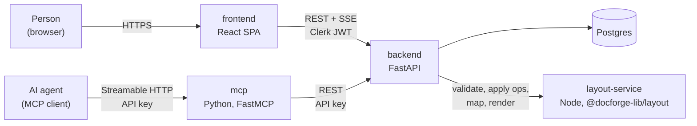

# DocForge

[](https://github.com/maxjneto/doc-forge/actions/workflows/ci.yml)


**Documents that people and their AI agents write together, with a person reviewing what the agent changes.**

An agent (Claude Code, Codex, Cursor or any MCP client) connects to DocForge with an API key and writes into the same document the person has open in the browser. Two kinds of document:

- **Markdown documents.** By default, every agent write becomes a *suggestion* the person reviews as a diff, hunk by hunk, before it lands. Versions, comments, a quality gate run by the agent, publishing and public links come with it.
- **Layout documents** — pages and slides made of components placed on a grid (text, tables, KPIs, charts, steps, timelines, cards). The agent never sees the page: it reads a text map of each page, and every write tells it what the layout did on its own (what moved, grew or split). The person edits the same document in a visual editor. The engine is [`@docforge-lib/layout`](https://github.com/maxjneto/docforge-layout), an open-source library.

**[doc-forge.dev](https://doc-forge.dev)**

> **Experimental** — DocForge is a work in progress and may change or be discontinued at any time.

## How it fits together



| Package | What it is |
|---|---|
| [`packages/backend`](packages/backend) | FastAPI API: documents, versions, suggestions, sharing, layout documents, plans and billing. Owns storage and permissions. |
| [`packages/frontend`](packages/frontend) | React 19 + Vite app: the Markdown editor with review, the layout editor, the dashboard and the public pages. |
| [`packages/mcp`](packages/mcp) | The MCP server agents connect to: 42 tools over Streamable HTTP, plus writing guides and recipes as resources. |
| [`packages/layout-service`](packages/layout-service) | The layout library's HTTP server, packaged for the backend (which is Python and cannot run it in-process). |

DocForge never calls a language model itself. Agents run on the person's side, with their own model and credentials; DocForge is where their work is stored, checked and reviewed.

## Documentation

- **[Running DocForge locally](docs/development.md)** — the stack in Docker, or each package on its own; tests; connecting an agent.
- **Architecture**, part by part:
  - [Overview](docs/architecture/overview.md) — services, request paths, and the decisions behind them
  - [Backend](docs/architecture/backend.md) — data model, auth, permissions, the review loop, plans
  - [Layout documents](docs/architecture/layout-documents.md) — the library, the layout service, revisions and publishing
  - [MCP server](docs/architecture/mcp.md) — transport, authentication, tools and resources
  - [Frontend](docs/architecture/frontend.md) — app structure, the two editors, the design system
- **[Deploying](docs/deploy.md)** — a single VPS with Docker Compose, CI/CD, backups and rollback.
- **[Contributing](CONTRIBUTING.md)** — branches, checks and commits.
- MCP reference: [tools](packages/mcp/TOOLS.md) and [setup](packages/mcp/README.md).

## Quick start

```bash
git clone https://github.com/maxjneto/doc-forge.git && cd doc-forge
cp packages/backend/.env.example packages/backend/.env     # set CLERK_JWKS_URL
cp packages/frontend/.env.example packages/frontend/.env   # set VITE_CLERK_PUBLISHABLE_KEY
docker compose up --build
```

Open http://localhost:5173. Signing in needs a (free) Clerk development instance; to look at every screen without one, run `npm run dev:preview` in `packages/frontend`. The details are in [docs/development.md](docs/development.md).

## Tech stack

| Layer | Technology |
|---|---|
| Frontend | React 19, TypeScript, Vite, Tailwind CSS v4, CodeMirror 6 |
| Backend | Python 3.11, FastAPI, SQLAlchemy 2 (async), Alembic, Pydantic v2 |
| Layout engine | [`@docforge-lib/layout`](https://www.npmjs.com/package/@docforge-lib/layout) (TypeScript, fontkit), resvg for page images |
| Agents | MCP over Streamable HTTP (Python MCP SDK) |
| Data | PostgreSQL 16; Redis optional (SSE fan-out across replicas) |
| Auth and billing | Clerk (people), hashed API keys (agents), Stripe |
| Analytics | PostHog (in the browser only after cookie consent) |
| Infrastructure | Docker Compose on a VPS, Caddy (automatic HTTPS), GitHub Actions → GHCR → SSH deploy |

## Legal

- [Terms of Use](packages/frontend/src/legal/terms.md)
- [Privacy Policy](packages/frontend/src/legal/privacy.md)

Licensed under the [MIT License](LICENSE).
