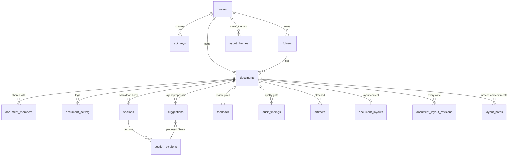
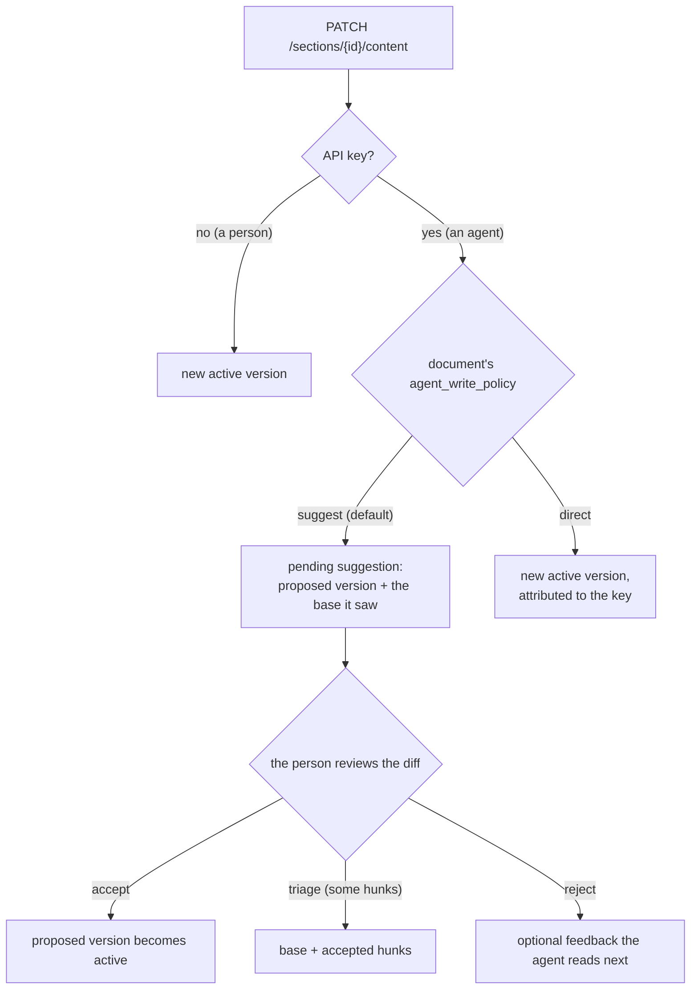

# Backend

`packages/backend` — Python 3.11, FastAPI, SQLAlchemy 2 (async, psycopg), Alembic, Pydantic v2.

The backend owns every rule: who may read or change a document, what an agent's write turns into, what a plan allows. The browser and the MCP server are both clients of it, and neither talks to the database.

## Layout of the code

```
app/
  main.py            app, CORS, request logging, routers, /health and /api/health
  config.py          settings (pydantic-settings, read from the environment and .env)
  auth.py            Clerk JWT and API-key authentication
  database.py        async engine and session dependency
  models/            SQLAlchemy models — the schema's source of truth
  schemas/           request and response models (Pydantic)
  routers/           HTTP endpoints, one module per area
  services/          the rules the routers share
  layout_templates/  starter layout documents offered in "New document"
alembic/versions/    migrations (001_baseline is the whole schema)
tests/               pytest, against SQLite in memory
```

| Router | Area |
|---|---|
| `documents` | create, list, read, rename, archive, export, publish, activity, the SSE stream |
| `sections` | Markdown content: write, versions, snapshots, restore |
| `suggestions` | agent suggestions (accept, reject, triage by hunk) and human feedback |
| `quality_gate` | findings submitted by the agent; whether they block |
| `artifacts` | diagrams, tables and decision notes attached to a document |
| `organization` | folders, sharing with roles, public links |
| `layout` | layout documents: ops, map, find, review, images, notes, revisions, themes, publishing |
| `users` | the current user, API keys, plans (`/tiers`), activity across documents |
| `billing` | Stripe checkout, customer portal, webhook |
| `telemetry` | usage reports from the MCP server |

## Data model



| Table | Holds |
|---|---|
| `users` | Clerk user id, email, plan, the weekly creation allowance (`credits`, `credits_reset_at`), Stripe ids |
| `api_keys` | agent keys: a name, the harness (Claude Code, Codex…), **only a SHA-256 of the key**, last use, revocation |
| `documents` | title, `document_mode` (`editor` or `layout`), owner, folder, `agent_write_policy`, `require_gate_on_accept`, `public_token`, `archived_at` |
| `sections`, `section_versions` | a Markdown document's text: one `body` section, a chain of versions with one active (the draft) and at most one published |
| `suggestions`, `feedback` | an agent's proposed version against the base it saw; the person's comments back |
| `audit_findings` | quality-gate findings (severity, the quoted phrase, a category), dismissable |
| `artifacts` | supporting material anchored in the text by a `::artefato[key]` directive |
| `folders`, `document_members` | nested folders; per-document sharing (`viewer`, `commenter`, `editor`), invitations by email |
| `document_activity` | who did what, attributed to the person or to the API key |
| `document_layouts` | a layout document's current JSON and revision, and the published snapshot |
| `document_layout_revisions` | every layout write: the operations, the resulting content, the author (person or key), names for saved versions |
| `layout_notes` | what the layout did on its own (notices) and what people pinned (comments, threads, requests to the agent) |
| `layout_themes` | named sets of design tokens a person can reuse |

The schema starts from one migration, `001_baseline`, generated from the models and checked against Postgres. New changes are new migrations on top of it (`alembic revision --autogenerate -m "…"`, then read and adjust it). The partial unique indexes that guarantee one active and one published version per section are Postgres-only; the tests (SQLite) drop the one SQLite cannot express.

## Authentication

Two kinds of caller, one dependency (`get_current_user`):

- **People** send a Clerk session token (`Authorization: Bearer <JWT>`). The backend verifies it against Clerk's JWKS (cached for an hour), checks `azp` against `CLERK_AUTHORIZED_PARTIES`, and creates the `users` row on first sight.
- **Agents** send `X-API-Key`. The backend hashes it, finds a non-revoked key, records its use, and loads the key's owner. The key's id goes on `request.state.api_key_id`, so everything the request does is attributed to the agent, not to the person.

An API key acts as its owner: it can do what the owner can do. What differs is how writes are treated (below) and how they are shown.

## Permissions

`services/access.py` is the only place that answers "may this user do this to this document?". Roles, least to most capable: `viewer` → `commenter` → `editor` → `owner`.

| Capability | Needs |
|---|---|
| `read` | viewer |
| `comment` | commenter |
| `write` | editor |
| `manage` (share, publish, archive, delete) | owner |

An invitation to an email with no account yet waits in `document_members`; once that person signs up, it becomes theirs the first time they list the documents shared with them. A public link is a separate thing: `public_token` is a random capability, and holding it grants read access to what was published, nothing else.

## The review loop (Markdown)

The text of a Markdown document is a chain of versions:

- the **active** version is the working draft, and it is what the editor shows;
- a **published** version is the one people are meant to read ("v4" while you edit "v4 → v5 draft");
- **snapshots** are named versions; a person or an agent can restore any of them.

How a write lands depends on who sends it:



- A suggestion is **stale** when the document moved on after the agent read it; it is still reviewable, and the diff is always against the current active version.
- **Triage** is computed on the server (`services/hunks.py`), which mirrors the browser's diff (`utils/diff.ts`): the browser numbers the hunks, the server applies the ones the person kept. Accepting everything gives the proposal; accepting nothing gives the original.
- **Appends** (`mode: "append"`) are concatenated on the server, so an agent can add to the end without resending the document.
- Free plans keep a limited number of inactive versions per section; the oldest are pruned when a new one is created.

## Quality gate

"CI for documents." The agent audits the document with its own model (the `quality-gate` recipe explains how) and submits findings: a severity, a description, the exact phrase it is about, a category. DocForge stores them and shows each one underlined in the text. When a document turns on `require_gate_on_accept`, open high-severity findings block accepting suggestions and publishing until they are resolved or dismissed.

## Real-time updates

`GET /api/documents/{id}/stream` is a server-sent events stream. Writes publish small events (`section_updated`, `suggestion_created`, `feedback_resolved`, `layout_note_changed`, …); the browser reacts by fetching what changed. Delivery is in-process by default (one backend replica). With `REDIS_URL` set, events go through Redis pub/sub so every replica receives them.

## Plans, the weekly allowance and billing

- **Plans** live in one place, `services/tiers.py`, and are served at `GET /api/tiers`, which the pricing and billing pages read. Limits are enforced on the server: active documents, connected agents (API keys), versions kept, export formats.
- **Creating a document** (Markdown or layout, by a person or an agent) uses one creation from the week's allowance. The allowance refreshes on the first request after Monday 00:00 UTC; there is no scheduler. Editing, reviewing, publishing and sharing never use it.
- **Billing** is Stripe, off by default (`STRIPE_ENABLED=false`, every billing endpoint then answers 409 instead of failing on missing keys). With it on: Checkout for upgrades, the customer portal for changes, and a webhook (`checkout.session.completed`, `customer.subscription.updated|deleted`) that sets the user's plan.

## Export

Markdown documents export as Markdown, PDF or Word, rendered in pure Python (`markdown` → HTML → `xhtml2pdf` / `htmldocx`), so the image needs no browser and no system libraries. The formats a plan may use come from its tier. Layout documents are printed from the browser and rendered by the library.

## Telemetry

PostHog, off unless `POSTHOG_ENABLED=true`. The backend records product events (document created, suggestion accepted, layout write…) and, for every request made with an API key, the route, status and duration (`mcp_api_request`). The MCP server reports each tool call's duration and response size (`POST /api/telemetry/mcp-tool`). `scripts/setup_posthog_funnel.py` creates the activation funnel in PostHog.

## Configuration

Every setting has a default in `app/config.py`; `.env.example` lists the ones you usually set. The important ones:

| Setting | Purpose |
|---|---|
| `DATABASE_URL` | Postgres (`postgresql+psycopg://…`) |
| `CLERK_JWKS_URL`, `CLERK_AUTHORIZED_PARTIES` | verifying people's tokens |
| `CORS_ORIGINS` | the frontend's origin |
| `LAYOUT_SERVICE_URL` | the internal layout service |
| `REDIS_URL` | optional SSE fan-out |
| `FREE_*`, `PRO_*` | plan limits and weekly allowances |
| `STRIPE_*` | billing |
| `POSTHOG_*` | analytics |

## Tests

```bash
cd packages/backend
pip install -e ".[dev]"
pytest tests -q        # ~140 tests, SQLite in memory, no services needed
ruff check .
```

The suite is hermetic: it forces Stripe and PostHog off whatever your `.env` says, overrides authentication with a test user, and mocks the layout service where a test needs it. CI also runs `alembic upgrade head` against a real Postgres.
