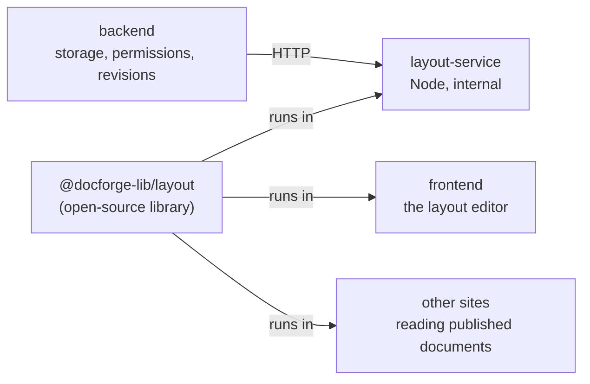

# Layout documents

A layout document is a page (or a slide deck) made of **components placed on a grid**: text, lists, tables, code, steps, timelines, KPIs, cards, charts, images and dividers. An agent builds it without ever seeing it; a person refines it in a visual editor; the result prints to PDF, presents as slides, or is published for other sites to load.

Three pieces make it work:

## The library: `@docforge-lib/layout`

Repository: [maxjneto/docforge-layout](https://github.com/maxjneto/docforge-layout) · npm: [`@docforge-lib/layout`](https://www.npmjs.com/package/@docforge-lib/layout)

The library is the format and the engine. It stores nothing; given a document it can validate, measure, lay out, paginate, describe and render it. The same code runs in Node and in the browser, so what the agent is told and what the person sees cannot disagree.

### Measuring without a browser

The problem an agent has with documents is that it cannot see them: it does not know a paragraph will take nine lines and push the chart onto the next page. The library answers that without a browser:

- Fonts are bundled (Inter, Source Serif 4, Space Grotesk, JetBrains Mono) and read with **fontkit**, the same files in Node and in the browser. System fonts are never used.
- The library decides every line break itself (`Intl.Segmenter`, word granularity) and renders **each line as its own block**, so a box's height is `lines × line height`, exactly, in both places.
- Components that hold content (text, lists, tables, code, steps, timelines, cards) grow to fit it; KPIs, charts, images and dividers fill the height they are given.

### The grid and the layout

Positions are in **units** (8 px by default) from the top-left of a page's content area: `{page, x, y, w, h?}`. Twelve guide columns help alignment but constrain nothing. A position is what the author asked for; the layout is what happens:

- A box that grows pushes down only what it runs into, in a chain. The stored position stays as written, so a pushed box returns when its pusher shrinks.
- A box crossing the bottom of a page **splits** (text, lists, tables, code, steps, timelines) or moves to the next page.
- Nothing about layout refuses a write: every side effect is reported as a change (moved, grew, split, clamped, page count).

Styles cascade from a preset, to the document (by type or role), to a region of the grid, to classes (labels), to the component, with design tokens (`$color.primary`, `$size.lg`, `$space.3`…) underneath. A theme is a set of tokens.

### What an agent reads: the text map

Instead of a picture, the agent reads each page drawn in ASCII plus a table of components (position, size, what moved and why, problems), at three levels of detail. Every write answers with a short **summary**: what you changed (before → after), what moved on its own, problems, free rows per page. That summary is usually all the agent needs before its next step.

### Changing a document: operations

Agents (and the editor) change documents with operations, applied atomically by the library:

| Operation | Does |
|---|---|
| `add`, `place`, `remove` | add a component at a position (absolute, `below` another, or at the `end` of a page; `cols` for width) |
| `row` | put several components side by side across the guide columns, in proportions |
| `update`, `edit`, `replaceText` | replace content, change parts of it by path (`rows.2.0`, `items.3`), find and replace |
| `move` | take a block of components before or after another; what was below moves up, the rest makes room |
| `compact`, `fit` | close empty space; make the document fit N pages, mildest strategy first (compact, heights; spacing and type only when asked) |
| `setStyle`, `setTokens`, `setRegion`, `setGrid`, `setSurface`, `setMeta` | styles, theme, grid, page size (A4, Letter, slides…) |
| `page` | insert, duplicate, remove or reorder whole pages and slides |

Operations are checked against a schema before they run, so a malformed one is a diagnostic that names the bad field, never an exception.

### Formats

Documents carry `format: "docforge/layout"` and a `version` (currently 3). A newer library upgrades older documents on read; DocForge converts a document *down* for a reader that asks for an older version, so a site pinned to an older library keeps working.

## The layout service

`packages/layout-service` runs the library's own HTTP server (`docforge-layout serve`) in a small Node image. It has no code of its own: the package only pins the library version and adds `@resvg/resvg-js`, which turns pages into PNGs without a browser.

| Route | Used for |
|---|---|
| `POST /validate` | checking a document (and drawing its map) |
| `POST /apply` | applying operations — also the preview, since it never saves |
| `POST /map`, `/find`, `/review` | the text map, finding components, what a reader would notice |
| `POST /measure` | how tall a component would be at given widths |
| `POST /diff`, `/locate` | side effects between two versions; where comments are anchored |
| `POST /render`, `/render-image` | HTML for printing; a page as PNG for agents that can see images |
| `POST /upgrade` | converting a document between format versions |

The service is stateless and unauthenticated: it is reachable only on the internal network (no published port, no proxy route). `test/contract.test.mjs` pins the routes and fields the backend relies on, so a library upgrade that changes them fails in CI.

## What the backend adds

The backend never interprets the JSON; it owns what the library cannot:

- **Storage and permissions.** `document_layouts` holds the current content and revision; access goes through the same roles as every document.
- **Revisions.** Every write is a row in `document_layout_revisions` with the operations, the resulting content and its author (a person or an API key). A revision can be named (a saved version), compared and restored.
- **Concurrency.** A write is a compare-and-swap on the revision. If someone else wrote in between, it is refused with `409 STALE_REVISION`; the editor then shows what changed and reapplies its own pending work.
- **Notes.** What the layout did on its own becomes *notices* (a box pushed to the next page, a page added). People pin *comments* on a component or an area; a comment can be addressed to the agent, which sees it first the next time it opens the document and replies in the thread. An agent can hand the document back with a review request: a summary, what to look at, questions with options.
- **Themes.** People save sets of tokens and apply them to any document.

### Publishing

Publishing **copies** the current revision into `published_content`. Readers get that snapshot, never the draft, and keep getting it if the document changes later or DocForge is unreachable from their cache:

- `GET /api/public/{token}/layout` — no authentication (the token is the capability), CORS `*`, an `ETag` for revalidation, `Cache-Control: public, max-age=60`, and a per-address rate limit.
- `?format=2` asks for an older format version; the response then lists what the conversion dropped.
- The library's client (`fetchPublished(url)`) reads it from any site. CopaSim, for example, renders announcements written as DocForge documents.

## The editor

The person's side is described in [Frontend](frontend.md#the-layout-editor): the pages are drawn by the library's own HTML inside a sandboxed iframe, with a selection layer on top; edits become the same operations an agent sends.
