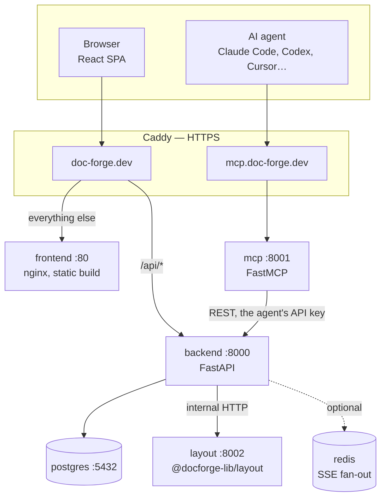
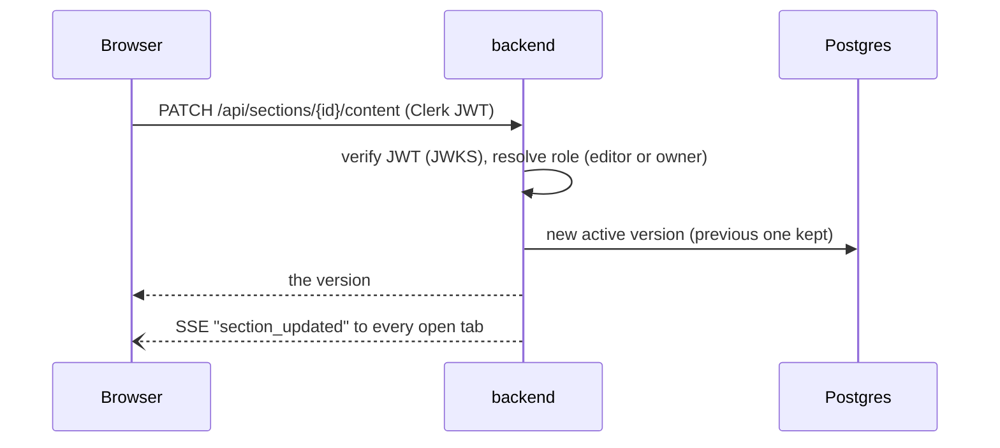
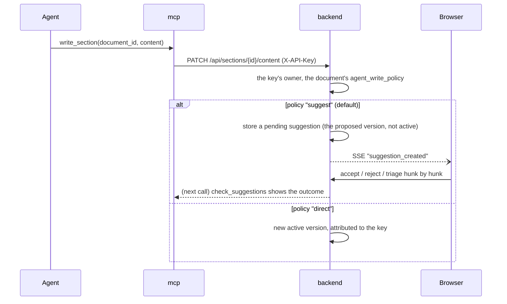
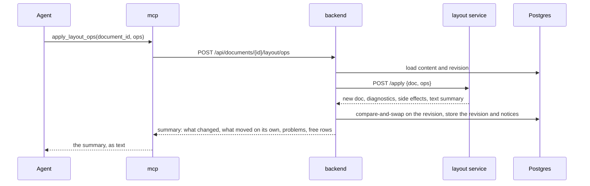

# Architecture overview

DocForge is a place where a person and the AI agents they connect work on the same document. The person uses the browser; the agent uses MCP tools. Both reach the same backend, which stores the document, decides who may change it, and records who changed what.

This page gives the big picture. Each part has its own page:

| Page | Covers |
|---|---|
| [Backend](backend.md) | Data model, authentication, permissions, the review loop, versions, plans and billing |
| [Layout documents](layout-documents.md) | The `@docforge-lib/layout` library, the layout service, revisions, notes and publishing |
| [MCP server](mcp.md) | How agents connect, the tools and resources, telemetry |
| [Frontend](frontend.md) | App structure, the Markdown editor, the layout editor, the design system |

## Services



| Service | Language | Public? | Responsibility |
|---|---|---|---|
| `frontend` | TypeScript (React) | yes, `/` | The app and the marketing pages, built once and served as static files |
| `backend` | Python (FastAPI) | yes, `/api` | Every rule: storage, permissions, revisions, suggestions, plans, billing |
| `mcp` | Python (MCP SDK) | yes, MCP host | Translates MCP tool calls into backend calls, with the agent's API key |
| `layout` | Node (the layout library) | no | Validates layout documents, applies operations, draws text maps and page images |
| `postgres` | — | no | The only state |

Only the backend talks to the database and the layout service. The MCP server is a client of the backend like the browser is: it has no database access and holds no state of its own.

## Two documents, one model

Every document is a row in `documents` with a `document_mode`:

- **`editor`** — a Markdown document. Its text is one Markdown body, stored as a chain of versions (`sections` → `section_versions`). Headings give it structure, but storage does not slice it: navigation, review and diffs derive sections from the text when they need them.
- **`layout`** — a layout document. Its content is one JSON document in the library's format (`document_layouts`), with every write kept as a numbered revision.

Both kinds share the rest: ownership, folders, sharing with roles, activity, archiving and the weekly creation allowance.

## Request paths

### A person edits a Markdown document



People write directly: an autosave sends the text after a short pause, and the backend makes it the new active version.

### An agent writes the same document



The agent's write does not land until the person accepts it, unless the person chose `direct` for that document. The review is a diff, and the person can accept part of it: triage applies the chosen hunks and leaves the rest out. Rejections can carry feedback the agent reads before its next write.

### An agent changes a layout document



The agent never sees the page. It reads a text map (each page drawn in ASCII plus a table of components), sends operations, and gets back a short summary of what the layout did. See [Layout documents](layout-documents.md).

## Decisions worth knowing

- **DocForge does not call a model.** It used to run a hosted, six-phase AI workflow (discovery, alignment, generation, refinement, audit). It was removed: agents people already use write better with their own context, and the product's value is the review and the format, not the generation. The quality gate is also run by the agent, which submits its findings.
- **A write that only changes the layout is never refused.** A layout write is refused only when it cannot be used: a malformed operation, an unknown id, an invalid document. A box pushed to the next page, a table that now splits or a page limit exceeded is accepted and reported, so the agent learns the consequence instead of guessing why it was blocked.
- **Compare-and-swap, not locks.** Layout writes carry the revision they were based on; if someone else wrote in between, the write is refused with `409 STALE_REVISION` and the client reads again. Markdown writes from agents become suggestions, which carry the version they were based on and are marked stale when the document moved on.
- **Python backend, TypeScript engine.** The layout library has to run in the browser (the editor measures as you type) and on the server. Rather than port it, the backend calls it over HTTP in a small internal Node service that has no code of its own: the library ships the server.
- **The JSON is the document.** A published layout document is copied at publish time, so a site that embeds it keeps working even if DocForge is down or the document changes later. Readers with an older library version ask for their format and get the document converted down.
- **One process per service, one replica.** Server-sent events are delivered from in-process queues. Setting `REDIS_URL` switches delivery to Redis pub/sub so the backend can run more than one replica.

## Where things live

```
packages/
  backend/          FastAPI app (app/), Alembic migrations, tests
    app/routers/    one module per area: documents, sections, suggestions, layout, …
    app/services/   the rules: access, credits, tiers, layout client, SSE, export
    app/models/     SQLAlchemy models (the schema's source of truth)
  frontend/         React app (src/), design preview (preview/), token guard (scripts/)
  mcp/              MCP server (src/docforge_mcp/), resources (guides, recipes)
  layout-service/   package.json + Dockerfile that run the library's server
deploy/             Caddy configuration and the production env template
docs/               this documentation
scripts/            smoke test of the MCP flow, vendoring of unreleased library builds
```
