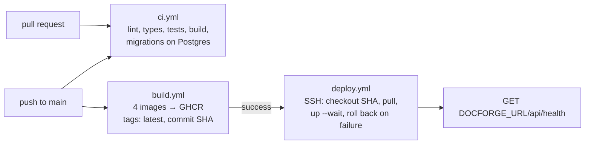

# Deploying DocForge

DocForge runs on a single VPS with Docker Compose. Images are built by GitHub Actions and pulled by the server, which never builds anything. Caddy terminates HTTPS with certificates it obtains on its own.

Two setups share the same files:

| Setup | Compose files | Who owns ports 80/443 |
|---|---|---|
| **Standalone** — DocForge has the box to itself | `docker-compose.prod.yml` | DocForge's Caddy |
| **Colocated** — the box already runs another app with its own Caddy (production runs this way, next to CopaSim) | `docker-compose.prod.yml` + `docker-compose.colocated.yml` | the other app's Caddy, which proxies to DocForge over a shared Docker network |

## What runs

| Service | Image | Reachable from the internet |
|---|---|---|
| `caddy` (standalone only) | `caddy:2-alpine` | 80, 443 |
| `frontend` | `ghcr.io/<owner>/doc-forge-frontend` (nginx + the built app) | through Caddy, `/` |
| `backend` | `ghcr.io/<owner>/doc-forge-backend` | through Caddy, `/api/*` |
| `mcp` | `ghcr.io/<owner>/doc-forge-mcp` | through Caddy, the MCP host |
| `layout` | `ghcr.io/<owner>/doc-forge-layout` | no |
| `postgres` | `postgres:16-alpine` | no |

Every app container has a healthcheck. The colocated override also gives each one a memory ceiling and a low CPU weight, so under contention the other app wins and a runaway DocForge process is killed instead of the box swapping. At rest the whole stack uses about 450 MB.

## Pipeline



- **`ci.yml`** runs on pull requests and pushes to `main` and `develop`: backend (ruff, pytest, `alembic upgrade head` on Postgres 16), frontend (types, design-token guard, tests, build), MCP (ruff, pytest), layout service (contract tests).
- **`build.yml`** runs on pushes to `main`: builds the four images on GitHub's runners and pushes them to GHCR tagged `latest` and with the commit SHA. `VITE_*` values are baked into the frontend image here.
- **`deploy.yml`** runs when a build succeeds (or by hand, with any built SHA). Over SSH it checks out that commit on the server, pins `IMAGE_TAG` to it, pulls, and runs `docker compose up -d --wait`, which waits for every healthcheck. If a container never turns healthy, it starts the previous tag again (kept in `.deployed-tag`) and fails the job. Finally it checks `/api/health` from outside.

Branches: work happens on `feat/*` and `fix/*` branches, merged into `develop` by pull request; `develop` is merged into `main` to release. Only `main` deploys.

### GitHub configuration

| Kind | Name | Value |
|---|---|---|
| Secret | `VITE_CLERK_PUBLISHABLE_KEY` | Clerk publishable key of the **production** instance |
| Secret | `VITE_POSTHOG_KEY` | optional |
| Variable | `VITE_MCP_URL` | e.g. `https://mcp.doc-forge.dev/mcp` (shown in every setup snippet) |
| Variable | `VITE_POSTHOG_HOST` | optional |
| Secret | `VPS_HOST`, `VPS_USER`, `VPS_SSH_KEY` | the server, and a key made only for deploys |
| Secret | `VPS_PATH` | optional, default `$HOME/docforge` |
| Variable | `DOCFORGE_URL` | e.g. `https://doc-forge.dev`, checked after each deploy |

Without `VPS_HOST` the deploy job skips itself, so forks stay green.

## First setup

### 1. DNS

Two `A` records to the server's IP: the app (`doc-forge.dev`) and the MCP host (`mcp.doc-forge.dev`). On Cloudflare, keep them **DNS only** (grey cloud): Caddy needs to reach Let's Encrypt directly to issue certificates.

### 2. The server

Docker Engine with the Compose plugin. Then:

```bash
git clone https://github.com/maxjneto/doc-forge.git ~/docforge && cd ~/docforge
cp deploy/.env.prod.example .env
nano .env        # domains, POSTGRES_PASSWORD (openssl rand -hex 24), CLERK_JWKS_URL, Stripe, PostHog
```

`COMPOSE_FILE` in `.env` picks the setup: `docker-compose.prod.yml` alone for standalone, `docker-compose.prod.yml:docker-compose.colocated.yml` for colocated. If the GHCR packages are private, run `docker login ghcr.io` once with a token that has `read:packages`.

### 3a. Standalone

```bash
docker compose pull && docker compose up -d --wait
```

Caddy reads `deploy/Caddyfile` and issues certificates on the first request.

### 3b. Colocated

```bash
docker network create edge                     # once per server
docker compose pull && docker compose up -d --wait
```

Then, on the host app's side:

1. Its Caddy container joins the `edge` network **in that app's compose file** (`networks: [default, edge]`, with `edge` declared `external: true`). Connecting it by hand with `docker network connect` does not survive the container being recreated by that app's deploy.
2. Paste the two site blocks of `deploy/Caddyfile.colocated.snippet` into its Caddyfile and reload it.

DocForge's containers are reachable on `edge` as `docforge-backend`, `docforge-frontend` and `docforge-mcp`; Postgres and the layout service stay on DocForge's private network.

### 4. Check

```bash
docker compose ps                              # every service "healthy"
curl -s https://doc-forge.dev/api/health       # {"status":"ok"}
DOCFORGE_API_KEY=<key> python scripts/smoke-mcp.py --url https://mcp.doc-forge.dev/mcp
```

### 5. Third parties

- **Clerk** — a production instance on the app's domain (Clerk shows the DNS records to add), with its own OAuth credentials for Google/GitHub sign-in. `CLERK_JWKS_URL` in `.env` and `VITE_CLERK_PUBLISHABLE_KEY` in GitHub must come from the same instance.
- **Stripe** — the webhook endpoint is `https://<domain>/api/webhooks/stripe`, listening to `checkout.session.completed`, `customer.subscription.updated` and `customer.subscription.deleted`. Its signing secret goes in `STRIPE_WEBHOOK_SECRET`.

## Operating

### Rolling back

Automatic when a deploy fails its healthchecks. By hand, redeploy any built commit: *Actions → Deploy (VPS) → Run workflow* with the SHA, or on the server:

```bash
IMAGE_TAG=<sha> docker compose up -d --wait
```

The schema only moves forward: a rollback across a migration needs the database restored from a backup.

### Backups

A daily `pg_dump`, kept for 14 days:

```bash
mkdir -p ~/docforge/backups
( crontab -l 2>/dev/null; echo '15 4 * * * docker exec docforge-postgres-1 pg_dump -U postgres docforge | gzip > ~/docforge/backups/docforge-$(date +\%F).sql.gz && find ~/docforge/backups -mtime +14 -delete' ) | crontab -
```

Restore into a fresh volume with `gunzip -c <file> | docker exec -i docforge-postgres-1 psql -U postgres docforge`. Copy backups off the server as well.

### Monitoring

An external uptime check (UptimeRobot or similar, free) on `https://<domain>/api/health` and on the MCP host catches what the healthchecks cannot see: DNS, certificates, the proxy.

### Logs

```bash
docker compose logs -f backend          # or mcp, layout, frontend
docker stats --no-stream                # memory against the ceilings
```

The colocated override rotates logs (10 MB × 3 per container).
