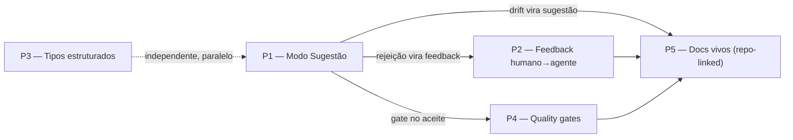

# DocForge — Plano de Produto

> **Atualização de 11/08/2026:** qualquer regra sobre créditos de IA, criação
> guiada hospedada ou exportação deve ser considerada substituída por
> [agent-first-document-quotas.md](agent-first-document-quotas.md).

> **Status:** rascunho vivo — base para discussão e priorização.
> **Criado:** 15/07/2026 · **Última atualização:** 15/07/2026
> **Escopo:** direção de produto centrada no MCP. Não cobre refatorações técnicas nem a recuperação da infra Azure (tratadas à parte).

---

## 1. Tese

O valor defensável do DocForge **não** está em "assistir o agente escrever" — render bonito + SSE + versionamento é reproduzível por qualquer concorrente em dias. O valor defensável está em ser:

> **A camada de revisão, confiança e manutenção de documentos escritos por agentes.**
> O agente propõe, o humano revisa com diff, o sistema audita — tudo atribuído, versionado e acumulando histórico.

Uma feature isolada é copiável. O que é caro de copiar: o workflow de aprovação, a trilha de auditoria por agente, as regras de qualidade automatizadas e o corpus de documentos que cresce com o uso.

## 2. Posicionamento

| | Hoje | Para onde vamos |
|---|---|---|
| Pitch | "Veja seu agente escrever em tempo real" | "Onde trabalho de agente vira documento confiável" |
| Categoria | Viewer/editor com MCP | Sistema de registro e revisão para docs de agentes |
| Escrita do agente | Direta no documento | Proposta pendente de aprovação (default) |
| Qualidade | Responsabilidade do usuário | Gates automáticos (contract + audit) |
| Retenção | Por documento criado | Pelo corpus e histórico acumulados |

---

## 3. Iniciativas

Ordem de prioridade definida em 15/07/2026: **P1 → P2 → P3 → P4 → P5**.

### P1 — Modo Sugestão ("PR model" para documentos)

**O que é.** Escritas do agente deixam de ir direto para o documento: viram **diffs pendentes** que o usuário revisa inline e aceita/rejeita por seção — como suggested edits do Google Docs ou review de pull request.

**Por que diferencia.** Ataca a dor central de quem usa agente para documentação: *"não confio 100% no que ele escreveu, e revisar um markdown inteiro é pior que revisar um diff"*. Muda a categoria do produto de viewer para camada de confiança.

**O que já existe no código para alavancar:**
- `SectionVersion` em árvore (`parent_version_id`) com flag `is_active` — uma sugestão é essencialmente uma versão não-ativa aguardando decisão.
- Diff viewer pronto no `EditorVersionPanel` (diff-match-patch).
- Atribuição por API key (`DocumentActivity`) — cada sugestão já nasce identificada por agente.

**Esboço de escopo (a detalhar):**
- *MVP:* `write_section` em modo sugestão (default configurável por documento); UI de revisão com aceitar/rejeitar por sugestão; notificação via SSE.
- *Depois:* aceite parcial (por trecho do diff); comentário ao rejeitar (alimenta P2); políticas por documento (agente X escreve direto, agente Y só sugere).

**Questões em aberto:**
- [ ] Default: sugestão obrigatória para todo write de agente, ou opt-in por documento?
- [ ] Como o agente toma conhecimento do resultado (aceito/rejeitado)? — conecta com P2.
- [ ] Conflito: usuário edita a seção enquanto existe sugestão pendente sobre ela.

---

### P2 — Feedback humano → agente dentro do documento

**O que é.** O usuário comenta ou marca trechos/seções ("esse timeout está errado, é 30s"), e esse feedback fica disponível ao agente via tool MCP (ex.: `get_pending_feedback`). Fecha o loop bidirecional — hoje só existe agente → humano.

**Por que diferencia.** Transforma a tela de acompanhamento em **superfície de colaboração assíncrona humano↔agente**. Exige estado, atribuição e desenho de protocolo dos dois lados — bem menos trivial de copiar que o render.

**O que já existe:** `ChatMessage` ancorado em documento/seção; SSE; painel de atividade.

**Esboço de escopo:**
- *MVP:* comentário ancorado em seção + tool MCP para ler feedback pendente + marcar como resolvido.
- *Depois:* ancoragem em trecho de texto (range); estados (aberto / endereçado / resolvido); rejeições de P1 viram feedback automaticamente.

**Questões em aberto:**
- [ ] Como a ancoragem em trecho sobrevive a reescritas da seção?
- [ ] Push (notificação ao agente) vs pull (agente consulta)? O modelo MCP atual favorece pull + recipe orientando o agente a consultar feedback antes de escrever.

---

### P3 — Tipos estruturados expostos ao agente (ADR, runbook, postmortem)

**O que é.** Expor a máquina `DocumentType` / `SectionDefinition` / `PromptTemplate` (hoje exclusiva do modo guiado) via MCP: o agente pede um "ADR" e recebe estrutura + regras por seção; o sistema valida o que ele escreve contra essa estrutura.

**Por que diferencia.** Agentes escrevem muito melhor com estrutura imposta — e ADR, postmortem e runbook são exatamente os artefatos que agentes geram a partir de contexto de repo/incidente. Custo baixo, reuso alto: é o acelerador barato da lista.

**O que já existe:** todo o sistema de tipos é database-driven; falta apenas expô-lo aos modos editor/MCP e criar seeds além de RFC.

**Esboço de escopo:**
- *MVP:* `list_document_types` + `create_document(type=...)` criando seções conforme a definição; validação estrutural no write.
- *Depois:* tipos custom por usuário; seeds novos (ADR, postmortem, runbook, design doc).

**Questões em aberto:**
- [ ] Documento tipado no modo editor: uma `Section` por `SectionDefinition`, ou body único com headings validados?
- [ ] Quais tipos-seed lançar primeiro e com quais prompts/regras?

---

### P4 — Quality gates ("CI para documentos")

**O que é.** Rodar as checagens de audit (consistência entre seções, drift de terminologia, contradições) e as regras do Document Contract sobre escritas de agente, com status visível no documento — "3 inconsistências de terminologia, 1 contradição com a seção X".

**Por que diferencia.** "Lint/CI para documentação escrita por IA" não existe como produto na categoria. Para o DocForge é reuso direto: `phases/audit/ai.py`, `contract.py` e `AuditFinding` já fazem o trabalho pesado no modo guiado.

**Esboço de escopo:**
- *MVP:* gatilho manual ou no snapshot → findings exibidos no documento (badge + painel).
- *Depois:* gate opcional bloqueante antes de aceitar sugestão (conecta com P1); contract editável pelo usuário como conjunto de regras do documento.

**Questões em aberto:**
- [x] Custo por execução: gate hospedado consome 1 crédito e dá refund em falha; gate executado pelo agente é gratuito. Regra consolidada em [credits-and-plans.md](credits-and-plans.md).
- [ ] Evento de disparo: a cada write? No snapshot? No aceite da sugestão?

---

### P5 — Documentos vivos ligados a repositório

**O que é.** Um documento declara vínculo com um repo/paths. Periodicamente (ou via webhook/CI), um agente relê o código, detecta drift entre código e documento e **propõe atualizações como sugestões** (P1), que o humano revisa.

**Por que é a aposta de longo prazo.** Documentação que se mantém verdadeira é uma dor universal e não resolvida. O valor cresce com o tempo de uso — é onde nascem retenção e moat de verdade (corpus + histórico + confiança acumulada). Importante: é **composição de P1 + P2 + P4**, não uma feature isolada — por isso fica no fim da fila sem prejuízo.

**Questões em aberto (é a iniciativa mais crua):**
- [ ] Quem executa a releitura do repo: o agente do próprio usuário (via recipe MCP) ou um serviço nosso? Implicações muito diferentes de custo, acesso e segurança.
- [ ] Granularidade do vínculo: repo inteiro, paths, símbolos?
- [ ] Primeiro alvo: README/ARCHITECTURE de projetos solo ou docs internos de time?

---

## 4. Sinergias e dependências

- **P1 é a fundação:** P2, P4 e P5 plugam nela.
- **P3 é independente** e barata — pode andar em paralelo a qualquer momento.
- **P5 depende de P1** (e idealmente P2 + P4) — coerente com ser a última.

## 5. Fora de escopo (por enquanto)

Table stakes de tier pago, sem valor de diferenciação agora — entram quando houver tração:

- Workspaces de time, SSO, permissões
- Exports (Confluence, Linear, PDF)
- OAuth no MCP em substituição a API keys
- Melhorias visuais do editor (a parte copiável)

## 6. Pré-requisitos operacionais (fora deste plano, mas bloqueiam)

- **Infra Azure fora do ar** (problema conhecido; correção planejada). Sem produção, nenhuma iniciativa é validável com usuários reais.
- **Testes do backend quebrados e fora do CI.** P1 mexe diretamente no write path de `SectionVersion`; fazer isso sem rede de testes é arriscado. Vale restaurar a suíte antes de implementar P1.

> Detalhamento e escopo completo da fundação técnica: **seção 10 (Fase 0)**.

## 7. Próximos passos deste documento

- [x] Max: adicionar ideias próprias (Ideias A e B — seção 8)
- [x] Rascunhar modelo de negócio por feature (seção 9)
- [x] Consolidar tudo em roadmap com milestones → **[roadmap.md](roadmap.md)**
- [x] Definir métricas de validação por marco (no roadmap)
- [ ] Benchmark de price points antes do M3 (go-to-market)
- [ ] Resolver as questões em aberto de P1 na entrada do M1 (decisões de entrada no roadmap)

## 8. Ideias adicionais (backlog de discussão)

### Ideia A — Pipelines de documento executáveis por agente (engenharia reversa do modo guiado)

> Proposta do Max em 15/07/2026. Candidata forte a virar o guarda-chuva das iniciativas P1–P4 no roadmap.

**O que é.** Transformar o modo guiado de *executor* em *definição de pipeline*: as fases (discovery → alignment → generation → refinement → audit), seus prompts e seus checkpoints deixam de ser código server-side que chama o Azure OpenAI e passam a ser servidos ao **agente do usuário via MCP** como instruções de etapa. O agente executa cada fase com as próprias ferramentas; o DocForge mantém a máquina de estados, valida submissões e trava nos checkpoints humanos (que continuam no browser). O baseline RFC de 6 fases vira o template canônico que o usuário **clona e customiza** — seus prompts, suas fases, seus gates.

**Fluxo esboçado.**
1. Agente: `get_next_step(document_id)` → servidor responde fase/seção atual + instruções (prompt da etapa).
2. Agente executa com ferramentas próprias (lê repo, conversa com o usuário no terminal) e submete o resultado.
3. Servidor valida (estrutura; futuramente gates P4), avança o estado ou bloqueia aguardando aprovação humana no UI.
4. Estado durável no DocForge ⇒ pipeline retomável se a sessão do agente morrer.

**Por que diferencia.**
- Resolve a metade fraca do produto: o modo guiado deixa de competir com "colar no chat" e vira o conteúdo que alimenta a rota MCP.
- **BYOA (bring your own agent):** o usuário traz o modelo de fronteira dele; custo marginal de IA da rota → ~zero; o problema do gpt-4o-mini datado desaparece nessa rota.
- Discovery executada pelo agente é *melhor*: ele lê o repositório e responde sozinho o que é factual, escalando ao humano só decisões/intenção.
- Pipelines customizadas = investimento do usuário no produto (moat por switching cost); potencial futuro de templates compartilháveis.

**O que já existe para alavancar.**
- Fases modulares com contratos de entrada/saída definidos (`app/phases/*`).
- Prompts em banco (`PromptTemplate`) + fallback YAML — já são dados, não código.
- Máquina de estados parcial (`Document.current_phase`, status de seções, `DocumentContract`).
- Infra de recipes/resources no MCP server (`docforge://recipes/*`) — o embrião de "servir instruções de etapa".

**Relação com P1–P5.** Engole P3 (tipo estruturado = caso trivial de pipeline); fornece a moldura onde P1 (sugestão), P2 (feedback) e P4 (gates) se encaixam como checkpoints; dá à P5 seu veículo de execução (drift check = pipeline agendada).

**Questões em aberto.**
- [ ] Modelagem: `PipelineDefinition` com etapas/transições/checkpoints — quanto de flexibilidade na v1? (clonar baseline + editar prompts, sem editor visual)
- [ ] Mantém o executor server-side (Inngest + Azure OpenAI) como rota paralela para usuários web-only, com a mesma definição de pipeline?
- [ ] Enforcement: como validar submissões de agentes não-cooperativos/imprecisos por etapa (estrutural agora, gates P4 depois)?
- [ ] Ergonomia MCP para workflows longos: retomada, descoberta do próximo passo, timeout de checkpoint humano.
- [x] Precificação da rota BYOA: não consome créditos. Créditos ficam restritos
  ao executor hospedado e a outros fluxos em que o DocForge paga os tokens.
  Regra operacional em [credits-and-plans.md](credits-and-plans.md).

### Ideia B — Biblioteca de resources no MCP: prompts de escrita por tipo de documento

> Proposta do Max em 15/07/2026. Acelerador barato — companheira natural da P3 e da Ideia A.

**O que é.** Além da pipeline, o MCP server oferece uma biblioteca de recursos para agentes: prompts de escrita para tipos específicos (ADR, postmortem, runbook, RFC), guias de estilo e exemplos — servidos via resources (`docforge://...`) e/ou MCP prompts parametrizados. Em duas camadas: **genéricos** (curados pelo DocForge, prontos para uso) e **customizados** (o usuário/time cadastra os seus).

**Por que diferencia.** O prompt genérico isolado é commodity (a parte mais copiável de todo o backlog) — o valor defensável está nas camadas acima:
1. **Fonte única com pipelines:** os mesmos `PromptTemplate` que alimentam etapas da Ideia A são servidos como resources — customizou uma vez, vale para os dois usos.
2. **Distribuição de padrões do time:** a organização codifica "como escrevemos postmortem aqui" e qualquer agente conectado passa a escrever nesse padrão. O MCP server vira canal de distribuição dos padrões de documentação.
3. **Hook de adoção:** valor imediato ao conectar, antes de qualquer compromisso com pipeline/revisão — topo de funil para os recursos pagos.

**O que já existe para alavancar.**
- `PromptTemplate` em banco (por tipo/fase/seção) — a fonte de conteúdo.
- Infra de resources/recipes no MCP server (`docforge://recipes/*`, `docforge://guide/system-prompt`) e `@mcp.prompt()` já em uso — o mecanismo de entrega.

**Relação com o resto.** É a metade *conteúdo* da P3 (que é a metade *estrutura*); no roadmap tendem a andar juntas. Com a Ideia A, compartilha a fonte de prompts (etapa de pipeline e resource lêem do mesmo lugar).

**Questões em aberto.**
- [ ] Mecanismo: MCP prompts parametrizados (aparecem em `prompts/list`) vs resources (URIs) — provavelmente ambos, com papéis distintos.
- [ ] Curadoria dos genéricos: quais tipos primeiro e quem escreve/mantém a qualidade.
- [ ] Prompts custom: CRUD na UI? Escopo por usuário ou por time (depende do futuro workspace)?
- [ ] Descoberta: como o agente sabe o que existe (index resource + menção no orientation prompt).

---

## 9. Modelo de negócio (rascunho)

> Registrado em 15/07/2026. Price points e integração de pagamento em aberto.

### 9.1 Papel do modo guiado

**Decisão (15/07/2026): o modo guiado permanece — sai do destaque do pitch, não do produto.** Três papéis comerciais:

1. **Executor hospedado.** Com a Ideia A, vira "mesma pipeline, dois executores": o DocForge executa (paga tokens → consome créditos) ou o agente do usuário executa (BYOA, custo ~zero para nós).
2. **Superfície de demo/onboarding.** Vendável no browser, sem setup de MCP — primeiro contato de usuários não-técnicos.
3. **Atende quem não tem agente** — mercado mais amplo que o público BYOA.

### 9.2 Princípio de precificação

> **Créditos só onde o DocForge paga tokens. Valor de workflow é assinatura.**

- Operações com custo real de IA (guided runs, gates server-side, drift check hospedado) → **créditos** (crédito = proxy de custo, papel correto dele).
- Features de workflow com custo marginal ~zero (sugestão, feedback, pipelines, prompts custom) → **features de plano**; medi-las por crédito cria atrito onde queremos adoção.
- Rota BYOA é barata de servir → generosa no Free. É motor de crescimento, não fonte direta de receita.

### 9.3 Comercialização por feature

| Feature | Custo marginal p/ DocForge | Comercialização |
|---|---|---|
| Editor livre + viewer tempo real + MCP básico | ~zero | Free (aquisição; limites: 1 agente conectado, N docs ativos) |
| Resources genéricos — prompts/recipes (Ideia B) | zero | Free (funil) |
| Modo guiado — executor hospedado | tokens por documento | Créditos (poucos no Free; mais nos pagos) |
| Modo sugestão + feedback (P1 + P2) | ~zero | **Pro** — núcleo do plano individual pago |
| Pipelines custom BYOA (Ideia A) | ~zero | Pro: clonar baseline + editar prompts |
| Tipos e prompts custom (P3 + Ideia B custom) | ~zero | Pro (individual); Team (compartilhado org-wide) |
| Quality gates (P4) | tokens quando server-run | Pro: server-run via créditos; executado pelo agente do usuário, incluído. Team: gate como política obrigatória por tipo de doc |
| Docs vivos (P5) | depende do executor | Team/add-on: drift check hospedado consome créditos; via agente do usuário, incluído no plano |
| Workspaces, SSO, trilha de auditoria por agente, exports | ~zero | Team, por assento |

**Argumentos de venda Team (organizacional, não conveniência):** distribuição de padrões de documentação via MCP para todos os agentes do time (Ideia B custom) + trilha de auditoria "quem — humano ou qual agente — escreveu o quê" (compliance).

### 9.4 Esboço futuro de tiers (não representa oferta vigente)

> O comportamento comercial disponível hoje está documentado em
> [credits-and-plans.md](credits-and-plans.md). Pro ainda não possui allowance
> própria de créditos e Team não está disponível.

- **Free** — funil: editor + MCP (1 agente, N docs ativos), resources genéricos, créditos semanais mínimos para experimentar o guided.
- **Pro** (evolução do "Builder") — indivíduo: P1+P2 (trust layer), pipelines/tipos/prompts custom, agentes ilimitados, histórico completo e exports (PDF). Uma allowance maior de créditos continua sendo hipótese, não benefício vigente.
- **Team** — organização: tudo do Pro, por assento + workspaces, padrões/pipelines organizacionais, gates como política, trilha de auditoria, SSO, exports Confluence/Linear.

### 9.5 Alavancas e riscos

- **Modelo de IA por plano no guided:** Free usa modelo econômico, pagos usam modelo superior — controla custo e cria razão de upgrade (o "priority generation" do pricing atual já apontava nessa direção).
- **Momento do pagamento:** Stripe entra quando a primeira feature Pro (P1) estiver entregável — não antes.
- **Calibragem do Free:** o funil MCP é o crescimento; Free estrangulado mata a tese antes de testá-la.
- **Higiene:** concluída — tiers e limites são servidos por `GET /api/tiers`; Pricing e Billing não mantêm números próprios.

### Questões em aberto

- [ ] Price points (exige benchmark de mercado — dev tools individuais e per-seat em 2026).
- [ ] Métrica de valor do Team: por assento, por agente conectado, ou híbrido?
- [ ] Créditos pagos: mensais + top-up avulso? Manter reset semanal só no Free?
- [x] Gates executados pelo agente do usuário não consomem crédito (incentivo pró-BYOA).
- [x] Limites atuais do Free: 10 documentos ativos, 20 versões por seção e 1 agente, todos configuráveis no backend.

---

## 10. Fase 0 — fundação técnica antes do roadmap

> Discutido em 15/07/2026. Proposta do Max: corrigir gerenciamento de contexto do guiado + escalabilidade (Redis pub/sub, caching, circuit breaker, etc.) antes do novo direcionamento. Posição registrada abaixo divide em "fazer agora" vs "diferir com gatilho" — recomendação do Claude, decisão final do Max.

### 10.1 Entra na Fase 0 (fazer antes do roadmap)

1. **Produção de volta ao ar** (problema Azure — já planejado).
2. **Restaurar a suíte de testes no CI** (6/29 falham por falta de seed de `DocumentType`; qualquer trabalho em fases/write path sem isso é arriscado).
3. **Contexto do modo guiado — diagnóstico + correção cirúrgica.** Suspeitos concretos identificados em `ai/core/truncation.py`:
   - Sumarização de chat antigo prometida no docstring mas **não implementada** — mensagens além da janela de 20 são simplesmente descartadas (decisões antigas do refinement somem).
   - Truncamento cego pela cabeça (`content[:limit]`) — audit/coherence perdem justamente o fim do documento, onde contradições escapam.
   - `build_context_report` loga `OVER_BUDGET` mas não age (detecção sem enforcement).

   *Método:* reproduzir localmente com casos reais → observar warnings `[truncation]` e traces PostHog → corrigir por fase (implementar sumarização, truncar preservando estrutura/cauda, budget com prioridade por componente). **Não é reescrita.** Bônus: o mapeamento "qual contexto cada fase precisa" é insumo direto das instruções de etapa da Ideia A.
   - Considerar upgrade de modelo junto (alavanca 9.5) — parte da perda percebida pode ser limitação do gpt-4o-mini em usar contexto longo.
4. **Fixar réplica=1 no Container App do backend** (custo zero) — guarda contra a quebra silenciosa do SSE in-process até o item 10.2.1.

### 10.2 Diferido com gatilho explícito

| Item | Gatilho para fazer | Racional |
|---|---|---|
| Redis pub/sub p/ SSE | Implementação de P1/P2 (tempo-real vira valor central) ou necessidade real de >1 réplica | Problema real mas só se manifesta com scale-out; troca contida (~1 dia) quando chegar a hora |
| Caching | Dados de latência/custo apontando hot path | Sem tráfego não há o que cachear; JWKS já é cacheado |
| Circuit breaker | Volume real com falhas em cascata observadas | Inngest já dá retries duráveis por step; `call_with_retry` cobre output malformado |
| Load balancing | — (não é item) | Ingress do Container Apps já faz |
| Retries HTTP adicionais | Oportunista, junto de outro trabalho no arquivo | Polimento, não projeto |

**Princípio:** problemas de escala se anunciam com dados (e a instrumentação PostHog existe para ouvi-los); problemas de qualidade/corretude são silenciosos. Fase 0 prioriza os silenciosos.

### Questões em aberto

- [ ] Max valida a divisão 10.1/10.2 (em especial: Redis agora vs no gatilho).
- [ ] Upgrade de modelo entra na Fase 0 ou no primeiro milestone do roadmap?
- [ ] Critério de saída da Fase 0 (o que significa "pronto para começar P1/pipeline"?).
