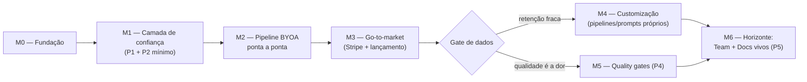

# DocForge — Roadmap

> **Status:** rascunho vivo — v1 consolidada em 15/07/2026.
> **Fonte:** decisões e iniciativas do [product-plan.md](product-plan.md) (tese, P1–P5, Ideias A/B, modelo de negócio, Fase 0).

## Como ler este roadmap

- **Marcos orientados a resultado, sem datas.** Projeto solo com dedicação variável — datas seriam ficção. O compromisso é com ordem e critérios de saída, não com calendário.
- **Esforço** em camisetas: **S** (~1 semana de trabalho focado), **M** (~2–3 semanas), **L** (~4+ semanas). Estimativas grosseiras, para comparação relativa entre marcos.
- Cada marco tem **decisões de entrada** (resolver antes de codar) e **critérios de saída** (o que significa "pronto").
- Depois do M3 existe um **gate de dados**: a ordem de M4/M5 é decidida com métricas reais, não agora.

## Visão geral

---

## M0 — Fundação (Fase 0) · esforço M

**Objetivo:** sistema de volta ao estado "confiável para construir em cima" — produção no ar, rede de testes, contexto do guiado corrigido.

**Entregas** (detalhadas na seção 10 do product-plan):
- [ ] Produção Azure restaurada (backend, MCP, frontend, DNS). **Segue bloqueado** — pré-requisito operacional fora do escopo de código, tratado à parte.
- [x] Suíte de testes do backend corrigida (seed de `DocumentType`) e **de volta ao CI** como gate de deploy. `tests/conftest.py` agora semeia `DocumentType`/`SectionDefinition` do RFC (espelhando a migração 006) antes de cada teste; `.github/workflows/docforge-backend-AutoDeployTrigger-*.yml` roda `pytest tests -q` como step obrigatório antes de build/push/deploy (falha do step para o job, não há `continue-on-error`). Suíte completa verificada em 2026-07-19: **85/85 passando**.
- [x] Correção do gerenciamento de contexto do guiado: `app/ai/core/truncation.py` agora implementa `compress_chat_history` (sumarização real, antes só prometida no docstring), `truncate_middle`/`_cut_keeping_tail` (preserva cabeça+cauda em vez de cortar cego pelo início) e `enforce_context_budget` (age sobre o orçamento em vez de só logar `OVER_BUDGET`). Coberto por `tests/test_truncation.py` (13 testes, incluindo reprodução do corte-cego-pela-cabeça e verificação de que cauda sobrevive).
- [x] Réplica=1 fixada no Container App — `docforge-backend-AutoDeployTrigger-*.yml` já faz `az containerapp update --min-replicas 1 --max-replicas 1`.

**Decisões de entrada:**
- Upgrade do modelo (gpt-4o-mini → modelo atual): entra aqui ou no M1? Recomendação: aqui, junto do trabalho de contexto — os dois se validam juntos. **Ainda em aberto** — não encontrada evidência de que o modelo foi trocado.

**Critérios de saída:**
- [ ] Demo pública funcionando ponta a ponta (documento guiado completo). **Bloqueado** pela produção Azure fora do ar — não verificável localmente como "demo pública".
- [x] CI verde com testes obrigatórios no pipeline de deploy. (Verificado em 2026-07-19 — ver Entregas acima.)
- [x] Casos de perda de contexto corrigidos e cobertos por teste (sumarização, truncamento cabeça+cauda, enforcement de budget — ver Entregas acima). Nota: a reprodução documentada é via `tests/test_truncation.py`, não incidente real de produção observado nesta sessão — se houver comparação "antes/depois" com caso real de usuário já feita em sessão anterior, vale anexar aqui.

---

## M1 — Camada de confiança (P1 + P2 mínimo) · esforço M/L

**Objetivo:** escritas de agente deixam de ser diretas — viram sugestões revisáveis. O produto muda de categoria (viewer → trust layer). É o núcleo do futuro plano Pro.

**Entregas:**
- [x] Modo sugestão: `write_section` gera versão pendente (não-ativa) em vez de escrita direta; default configurável por documento (`agent_write_policy`, default `suggest`).
- [x] UI de revisão: diff por sugestão, aceitar/rejeitar por seção, comentário na rejeição (`EditorVersionPanel`).
- [x] P2 mínimo: rejeição+comentário vira feedback consultável pelo agente (`get_pending_feedback` / `resolve_feedback` / status da sugestão via `check_suggestions`) — fecha o loop.
- [x] **Redis pub/sub para SSE** — `app/services/sse.py` publica em Redis quando `REDIS_URL` está configurado (com fallback automático para entrega in-process se não estiver). Código pronto; nenhuma instância Redis provisionada ainda no `docker-compose.yml` local nem confirmada em produção — falta só o "ligar".
- [x] Atribuição por agente nas sugestões — `Suggestion.api_key_id` → `agent_name` na resposta.

**Decisões de entrada** (questões abertas de P1 no product-plan):
- Default: sugestão obrigatória para agentes ou opt-in por documento? → Resolvido: default `suggest`, configurável por documento via `agent_write_policy`.
- Conflito: usuário edita seção com sugestão pendente — bloquear, rebasear ou invalidar? → Resolvido como "invalidar": suggestion fica marcada `is_stale` quando a versão ativa muda sob ela (ver `_to_response` em `routers/suggestions.py`), sem bloquear a escrita do usuário.
- Push vs pull para o agente saber do resultado. → Resolvido como pull: `check_suggestions` / `get_pending_feedback`.

**Critérios de saída:**
- [ ] Fluxo completo demo: agente escreve em modo sugestão → humano revisa diff no browser → rejeita com comentário → agente lê feedback e reescreve → humano aceita. **Coberto por teste de backend (mock), mas nunca demonstrado com agente real de ponta a ponta** — é o Cenário 2 de [docs/testing/mcp-manual-test-plan.md](../testing/mcp-manual-test-plan.md).
- [x] Testes cobrindo o write path de sugestões. `tests/test_suggestions.py` existe e passa (parte dos 85/85 verificados em 2026-07-19).

---

## M2 — Pipeline BYOA ponta a ponta (Ideia A slice + Ideia B genéricos) · esforço L

**Objetivo:** validar a tese BYOA — o baseline RFC de 6 fases executável de ponta a ponta pelo agente do usuário via MCP, com gates humanos. Sem customização ainda.

**Entregas:**
- [x] Máquina de estados de pipeline server-side sobre o baseline RFC (`app/services/pipeline.py`: discovery por seção → alignment → generation por seção → audit).
- [x] Tools MCP: `get_next_step` / `submit_step` — servidor serve instruções da etapa (prompts vindos de `PromptTemplate`), valida submissão (tamanhos mínimos por fase), avança estado.
- [x] Checkpoint humano de alignment no browser (`PipelineRun.status = waiting_human` bloqueia; endpoints `pipeline/approve` e `pipeline/reject`); escrita das etapas de geração via **sugestões do M1**.
- [x] Pipeline retomável: `get_next_step` deriva o estado inteiro do `PipelineRun` persistido — qualquer sessão nova retoma de onde parou. **Implementado, mas nunca testado contra uma interrupção real de sessão de agente** (ver Cenário 3 do test plan).
- [x] **Ideia B (genéricos):** `docforge://writing/{tipo}` (adr, postmortem, runbook, rfc) + prompt `write_document`, index via `docforge://writing`.
- [x] P3 parcial: `list_document_types` via MCP; e além do previsto para o M2 — tipos de documento **custom** (P3 completa, originalmente M4) já têm rota própria (`test_customization.py::test_custom_document_type_with_prompts_and_pipeline`).

**Decisões de entrada:**
- Grau de unificação com o executor server-side na v1 (mesma definição para os dois executores desde já, ou convergir no M4?). → Resolvido unificado desde já: `PipelineRun.steps` é a mesma estrutura para baseline e definições custom (`build_baseline_steps` / `build_steps_from_definition`).
- Enforcement de submissões: validação estrutural mínima aceitável por etapa. → Resolvido: mínimos de caracteres por fase (`MIN_DISCOVERY_CHARS`, `MIN_SUMMARY_CHARS`, `MIN_SECTION_CHARS`) em `services/pipeline.py`.

**Critérios de saída:**
- [ ] Um RFC real produzido de ponta a ponta por Claude Code através da pipeline, com aprovação humana nos checkpoints. **Código completo, validação real pendente** — Cenário 3 de [docs/testing/mcp-manual-test-plan.md](../testing/mcp-manual-test-plan.md).
- [ ] Pipeline retomada com sucesso após interrupção de sessão. **Idem** — é justamente a parte do Cenário 3 que exige encerrar e reabrir uma sessão de agente de verdade; não dá para provar isso com testes de backend mockados.
- [ ] Resources genéricos consumíveis por qualquer cliente MCP. Os resources existem e servem conteúdo correto; falta confirmar consumo por um cliente MCP diferente do Claude Code (Cenário 5 do test plan é só com Claude Code).

---

## M3 — Go-to-market (monetização + lançamento) · esforço M

**Objetivo:** existe algo vendável (P1+P2+pipeline+resources = pacote Pro coerente) — hora de cobrar e lançar.

> Nota: o product-plan dizia "Stripe quando P1 estiver entregável". Refinamento: P1 é condição *necessária*, mas o pacote Pro só fica vendável com M2 — cobrar por sugestão isolada seria pacote fino demais.

**Entregas:**
- [x] Stripe: assinatura Pro em modo teste (checkout, customer portal, webhook sincronizando plano). Testado ponta a ponta em 2026-07-18 com o `stripe listen` real: checkout hospedado completo com cartão de teste, assinatura criada, webhook sincronizou `plan=pro`. No processo, dois bugs de produção foram achados e corrigidos: (1) os objetos tipados do SDK novo do Stripe (`client.v1...`) não suportam `.get()` — todo acesso via `.get()` em `Subscription`/payload de webhook quebrava com `AttributeError`, mascarado nos testes porque os mocks usavam dicts simples; (2) `customer.subscription.deleted` rebaixava o usuário para free mesmo quando o evento era de uma assinatura antiga/duplicada, não a atual — corrigido para só agir quando o `subscription_id` do evento bate com o `stripe_subscription_id` salvo. A integração não define uma allowance Pro própria: durante o beta, Free e Pro recebem o mesmo `WEEKLY_CREDITS`. Faltam price point e política de créditos pagos antes da oferta comercial definitiva.
- [x] Tiers em fonte única servida pela API (elimina o hardcode divergente de PricingPage/BillingPage).
- [x] Limites do Free aplicados no backend (nº de agentes, docs ativos, retenção de versões).
- [ ] Lançamento: listagem em diretórios/registries MCP, README/demo atualizados (com produção no ar), post de lançamento (HN, communities de agentes). **Pendente — bloqueado por produção Azure fora do ar (pré-requisito da seção 6, tratado à parte).** `packages/mcp/server.json` já preparado no formato do registry oficial (schema `2025-12-11`), pronto para submissão quando a produção voltar; nada foi submetido a nenhum diretório ainda.
- [x] Eventos do PostHog instrumentados nos 4 passos do funil: `mcp_connected` (1ª chamada autenticada de uma API key), `mcp_document_created`, `suggestion_accepted`, `subscription_converted` (webhook Stripe). `scripts/setup_posthog_funnel.py` rodado em 2026-07-18 com credenciais reais — Insight "DocForge Activation Funnel" criado no projeto PostHog. `mcp_connected` e `subscription_converted` já dispararam de verdade (confirmado via 200 do endpoint de ingestão); indexação no PostHog é assíncrona, então a aparição no funil pode levar alguns minutos.

**Decisões de entrada:**
- Price points (benchmark de mercado — questão aberta da seção 9). **Benchmark levantado em 2026-07-19** (dev tools com IA, mercado US$, ver tabela abaixo) — decisão final de valor e moeda continua com o Max.
- Limites exatos do Free (calibrar generoso: o funil MCP é o crescimento). **Verificado em 2026-07-19 — já implementado e razoável, não é mais decisão em aberto:** `FREE_MAX_ACTIVE_DOCUMENTS=10`, `FREE_MAX_API_KEYS=1`, `WEEKLY_CREDITS=5`, `FREE_MAX_VERSIONS_PER_SECTION=20` (`app/config.py`), todos de fato enforçados (`services/tiers.py::check_document_limit`/`check_api_key_limit`, `services/db.py::_prune_old_versions`) e cobertos por teste (`test_tiers.py`, `test_version_retention.py` — incluindo o caso de borda "sugestão pendente sobrevive à poda"). Diferente de price points, não há benchmark externo direto pra "nº de docs ativos no free" — os números atuais já seguem o princípio generoso do §9.2; não há gap de implementação aqui.

**Benchmark de mercado (2026-07-19):**

| Produto | Individual | Team/seat |
|---|---|---|
| Cursor | Pro US$20/mês | Teams Standard US$40/user/mês |
| Windsurf | Pro US$20/mês | Teams US$40/user/mês |
| GitHub Copilot | Pro US$10/mês (Pro+ US$39) | Business US$19/user, Enterprise US$39/user |
| Linear (workflow, não-IA-first) | Basic US$10/user/mês | Business US$16/user/mês |
| Notion (IA bundlada, não add-on avulso desde 2026) | — | Business US$20/user/mês |

**Leitura:** ferramentas onde a IA *é* o produto (Cursor, Windsurf) convergem em **US$20/mês individual** e **US$40/user/mês em time** — virou o preço-âncora psicológico da categoria, não um cálculo de custo. Ferramentas de workflow que *incluem* IA (Linear, Notion) ficam mais baixas (US$10–20/user). O DocForge Pro (P1+P2 trust layer + pipelines BYOA) tem custo marginal de IA ~zero — mais parecido com a economia de Linear/Notion do que com a de Cursor/Windsurf — mas a categoria "produto com IA" já educou o mercado a pagar ~US$20 independente do custo real. Isso é argumento para ancorar no US$20/mês mesmo com custo baixo (captura disposição a pagar), não para ir mais barato.

**Achado ao verificar:** o price ID de teste hoje configurado no Stripe (`STRIPE_PRICE_ID_PRO`) está em **R$0,01/mês (BRL)** — claramente um placeholder, não uma decisão de preço. Isso também expõe uma decisão em aberto que o product-plan não menciona explicitamente: **BRL (mercado brasileiro) ou USD (mercado global de devs)?** Os comparáveis acima são todos em USD; se o Free/MCP funil trouxer usuários majoritariamente de fora do Brasil (plausível, dado que diretórios MCP e comunidades de agentes são predominantemente en-US), faz sentido precificar em USD desde o início em vez de converter depois.

Sources:
- [Cursor pricing 2026: Hobby, Pro, and Business plans compared](https://www.eesel.ai/blog/cursor-pricing)
- [Cursor · Pricing](https://cursor.com/pricing)
- [GitHub Copilot Pricing 2026: Pro $10, Pro+ $39, Max $100](https://automationatlas.io/answers/github-copilot-pricing-explained-2026/)
- [GitHub Copilot · Plans & pricing](https://github.com/features/copilot/plans)
- [Linear Pricing 2026: 4 Plans from Free–$16/user/month](https://costbench.com/software/developer-tools/linear/)
- [Notion AI Pricing 2026: Plans, Cost & Add-On Status](https://felloai.com/notion-ai-pricing/)
- [Windsurf Pricing 2026: Plans, Quotas & What Changed](https://www.verdent.ai/guides/windsurf-pricing-2026)

**Critérios de saída:**
- [x] Primeira cobrança real processada. (Checkout Stripe test-mode completo ponta a ponta em 2026-07-18 — assinatura `sub_1TuiLMLZ7C2nF1JQxMCUwqGp` ativa, plano sincronizado via webhook real. Falta só trocar chaves de teste por chaves live quando os price points forem decididos.)
- [x] Funil completo visível no PostHog. (Insight criado via API em 2026-07-18; `mcp_connected` e `subscription_converted` já dispararam de verdade a partir do fluxo real acima.)
- [ ] Produto listado e instalável a partir de pelo menos um diretório MCP. (Manifesto pronto; submissão pendente — depende de produção estar no ar.)

---

## ⛩️ Gate de dados (pós-M3)

Com usuários reais e funil instrumentado, os dados decidem a ordem dos próximos marcos:

| Sinal observado | Próximo marco |
|---|---|
| Retenção fraca / usuários pedem "do nosso jeito" | **M4** (customização = moat/switching cost) |
| Qualidade do output é a reclamação dominante | **M5** (quality gates) |
| Interesse de times/organizações aparecendo | antecipar partes do **M6** |

Ordem default se os dados forem inconclusivos: M4 → M5 (customização aprofunda o Pro existente).

---

## M4 — Customização (Ideia A completa + Ideia B custom + P3 completa) · esforço L

**Objetivo:** o usuário codifica o padrão *dele* — pipelines, prompts e tipos próprios. É a aposta de retenção/moat.

> **Nota de processo:** o código deste marco foi implementado **antes** do gate de dados pós-M3 apontar para cá — ou seja, à frente da própria metodologia que o roadmap define (linha 11: "a ordem de M4/M5 é decidida com métricas reais, não agora"). Não é um problema retroativo — o código existe e passa nos testes — mas a *decisão* de priorizar M4 não veio de sinal real de retenção. Vale registrar isso explicitamente antes de anunciar M4 como "entregue por prioridade validada".

**Entregas:**
- [x] `PipelineDefinition` como entidade: clonar o baseline (`POST /pipeline-definitions/clone`) e editar etapas/prompts (`PATCH /pipeline-definitions/{id}`, com validação estrutural via `validate_definition_steps`) — sem editor visual, edição de texto estruturado via `CustomizePage.tsx`. Gated para plano Pro (`_require_customization`).
- [x] CRUD de prompts custom na UI (`CustomizePage.tsx` → `DocumentTypesSection`); servidos como resources ao agente (mesma fonte `PromptTemplate` usada pelas pipelines).
- [x] Tipos de documento custom (P3 completa) — `test_customization.py` cobre criação de tipo custom com prompts e execução via pipeline; colisão de slug rejeitada.

**Critérios de saída:**
- [ ] Um usuário cria pipeline própria a partir do baseline e a executa via agente sem intervenção nossa. **Código e UI existem e passam em teste de backend (`test_clone_edit_and_run_custom_pipeline`); nenhum usuário real (nem o próprio Max) passou por esse fluxo na UI ainda.** Não incluído no test plan atual — se for validar M4 antes do gate de dados, vale um cenário próprio em [docs/testing/mcp-manual-test-plan.md](../testing/mcp-manual-test-plan.md).

---

## M5 — Quality gates (P4) · esforço M

**Objetivo:** auditoria automática sobre escrita de agente — o "CI para documentos".

> Mesma nota de processo do M4: implementado antes do gate de dados apontar pra cá.

**Entregas:**
- [x] Audit rodando sobre docs de agente: server-run (`POST /documents/{id}/quality-gate/run`, consome `QUALITY_GATE_COST` créditos, com refund se a run falhar) e agent-run via `docforge://recipes/quality-gate` + tools `get_quality_gate`/`submit_quality_findings` (gratuito, incentivo BYOA).
- [x] Badge/painel de findings no documento (`EditorGatePanel.tsx`).
- [x] Gate opcional bloqueante antes de aceitar sugestão — backend completo (`Document.require_gate_on_accept`, checado em `accept_suggestion`). **Gap encontrado e fechado em 2026-07-19:** não havia toggle na UI para ligar `require_gate_on_accept` — só existia leitura (`GateStatus`), nunca escrita. Adicionado `apiSetRequireGateOnAccept` (`utils/api.ts`) + botão "Require on accept: on/off" em `EditorGatePanel.tsx` (agora sempre visível, não só quando há findings). Verificado ponta a ponta via API real (`PATCH /documents/{id}` → `GET .../quality-gate` reflete a mudança); typecheck (`tsc --noEmit`) limpo. Não testado clicando no browser de verdade — só a chamada de API por trás do clique.

**Critérios de saída:**
- [ ] Gate detecta contradição plantada em teste real e bloqueia o aceite até resolução/dismissal. **Backend comprovadamente faz isso (`test_quality_gate.py`), mas com contradição plantada em teste automatizado, não em documento real revisado por humano** — Cenário 4 de [docs/testing/mcp-manual-test-plan.md](../testing/mcp-manual-test-plan.md) fecha essa lacuna, incluindo o contorno via `curl` para o toggle ausente.

---

## M6 — Horizonte: Team + Docs vivos (P5)

Sem escopo detalhado de propósito — depende do que o gate de dados e o M4/M5 revelarem. Componentes prováveis:

- Workspaces, SSO, distribuição org-wide de padrões (o argumento de venda Team da seção 9.3).
- Gates como política obrigatória por tipo de documento.
- P5: documentos vinculados a repositório com drift check (= pipeline agendada, sobre a infra do M4).
- Exports Confluence/Linear.

---

## Métricas de validação

**North star sugerida:** documentos com escrita de agente revisada por humano, por semana — captura exatamente a tese da camada de confiança.

| Marco | O que precisa ser verdade depois dele |
|---|---|
| M0 | Demo pública estável; zero regressão sem teste pegando |
| M1 | Taxa de aceite de sugestões observável (se ninguém revisa, a tese está errada — descobrir cedo) |
| M2 | ≥1 usuário externo completa um documento via pipeline BYOA |
| M3 | Conversão Free→Pro mensurável; CAC ~zero (orgânico/diretórios) |
| M4 | Pipelines custom criadas sem suporte nosso |
| M5 | Gates reduzem rejeição humana de sugestões (menos retrabalho) |

## Riscos transversais

- **Largura de banda solo** — o maior. Mitigação: marcos pequenos, corte vertical, nada de plataforma antes de validação (por isso M2 é hardcoded e M4 vem depois de dados).
- **Conta Azure** — risco já materializado uma vez; considerar simplificar a superfície de infra no M0.
- **Evolução do protocolo MCP** (auth OAuth, novas primitivas) — acompanhar spec; API keys funcionam hoje, migração eventual é table stakes (seção 5 do plano).
- **Custo do guided com modelo melhor** — mitigado pela alavanca "modelo por plano" (seção 9.5).
- **Risco de produto: agentes não cooperam bem com pipelines longas** — é exatamente o que o M2 valida cedo, antes de investir no M4.
